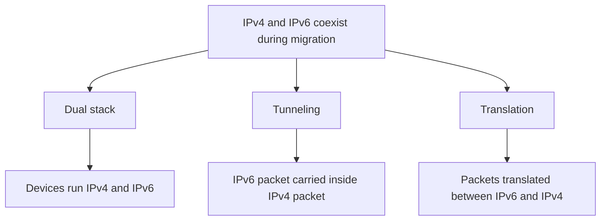
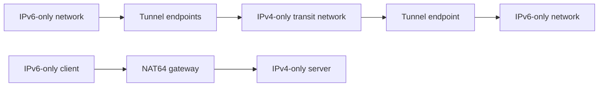

# IPv6: Why It Is Needed and How IPv4/IPv6 Coexist

> Cisco Networking notes — Module 10.1  
> Topic: The need for IPv6 and IPv4/IPv6 coexistence

## 1. Why IPv6 Was Developed

IPv6 (Internet Protocol version 6) was designed as the successor to IPv4. The main motivation was the limited IPv4 address space, but IPv6 also improves several aspects of IP networking.

### IPv4 address exhaustion

- IPv4 uses **32-bit addresses**, providing approximately **4.3 billion unique addresses** (`2^32`).
- The rapid growth of internet-connected devices made this address pool insufficient.
- Private IPv4 addressing and Network Address Translation (NAT) helped extend the usefulness of IPv4, but they did not create additional globally unique IPv4 addresses.
- NAT can complicate peer-to-peer connectivity and some applications because devices behind NAT may not be directly reachable from the public internet.

**Important distinction:** IPv4 exhaustion does not mean IPv4 stopped working or that all IPv4 addresses disappeared. It means Regional Internet Registries (RIRs) depleted their ordinary pools of unallocated IPv4 addresses and moved to restricted allocation policies.

### Historical RIR milestones

The Cisco course graphic gives these dates:

| Regional Internet Registry | Region served | Date shown |
|---|---|---|
| APNIC | Asia-Pacific | April 2011 |
| RIPE NCC | Europe, Middle East and parts of Central Asia | September 2012 |
| LACNIC | Latin America and the Caribbean | June 2014 |
| ARIN | United States, Canada and parts of the Caribbean | July 2015 |
| AFRINIC | Africa | 2020* |

*The 2020 AFRINIC date should be interpreted carefully: it marks the start of its final-/8 scarcity policy, not necessarily the same kind of complete exhaustion milestone as the other dates. RIR allocation policies and available address pools can differ.*

These are historical milestones, not a live measure of how many IPv4 addresses are currently in use.

## 2. IPv6 Address Capacity

IPv6 uses **128-bit addresses**, compared with IPv4's 32 bits.

- IPv4: `2^32` addresses (about 4.3 billion).
- IPv6: `2^128` addresses (about 3.4 × 10^38).

That is an enormously larger address space, suitable for continued internet growth and the increasing number of connected devices.

IPv6 is more than simply a larger address format. Its supporting protocols and design also improve network operation.

## 3. ICMPv6 and Address Configuration

IPv6 uses **Internet Control Message Protocol for IPv6 (ICMPv6)**.

ICMPv6 supports important functions, including:

- **Neighbor Discovery (ND):** discovers other devices on the local link and helps determine link-layer addresses. It performs functions that include the role of ARP in IPv4.
- **Router Discovery:** allows hosts to discover routers on the local network.
- **SLAAC (Stateless Address Autoconfiguration):** allows a host to create its own IPv6 address using information advertised by a router.
- **Error and diagnostic messages:** helps report delivery problems and supports network troubleshooting.

ICMPv6 is not simply an optional extra: it is important to normal IPv6 operation. Blocking all ICMPv6 traffic can break essential network functions.

## 4. Other Reasons for IPv6

### Internet of Things (IoT)

The Internet of Things refers to physical devices that connect to networks and exchange data. Examples include:

- Smart-home appliances and sensors
- Connected vehicles
- Industrial monitoring equipment
- Medical and wearable devices
- Environmental monitoring systems

As the number of connected devices grows, IPv6's large address space becomes increasingly useful.

### Limitations of relying on NAT

NAT conserves public IPv4 addresses by allowing multiple private-addressed devices to share one or more public addresses. However, it can complicate inbound connections, peer-to-peer applications, and troubleshooting.

IPv6 can support globally unique addressing without requiring address translation as a general design requirement. Firewalls and security policies are still necessary; globally addressable does **not** mean automatically exposed or unprotected.

---

## 5. IPv4 and IPv6 Coexistence

There is no single date on which every network must switch from IPv4 to IPv6. The transition takes place gradually, so both protocols coexist.

Network administrators use three common transition techniques:

### A. Dual stack

A device or network runs **IPv4 and IPv6 at the same time**.

- The device has IPv4 and IPv6 protocol stacks.
- It can communicate with IPv4 destinations using IPv4 and IPv6 destinations using IPv6.
- It is a practical way to introduce IPv6 while retaining compatibility with IPv4 services.

**Example:** A laptop has both an IPv4 address and an IPv6 address and can access services over either protocol when the network and destination support them.

```text
       IPv4 network       IPv6 network
             \             /
              \           /
             Dual-stack host
          (IPv4 + IPv6 enabled)
```

### B. Tunneling

Tunneling carries one IP protocol through a network that uses another protocol.

For IPv6 transition, an IPv6 packet can be **encapsulated inside an IPv4 packet** so it can cross an IPv4-only part of a network.

- The tunnel's entry point encapsulates the IPv6 packet.
- The IPv4 network transports the outer IPv4 packet.
- The tunnel's exit point removes the outer IPv4 header and forwards the original IPv6 packet.

```text
IPv6 network                                  IPv6 network
     |                                              |
 [Tunnel endpoint] ==== IPv4-only network ==== [Tunnel endpoint]
          IPv6 packet carried inside an IPv4 packet
```

Tunneling provides connectivity across IPv4 infrastructure, but it adds encapsulation overhead and requires tunnel configuration.

### C. Translation

Translation converts packets between IPv4 and IPv6 so that devices using different IP versions can communicate.

One example is **NAT64**:

- An IPv6-only client communicates with an IPv4-only server.
- A NAT64 device translates traffic between IPv6 and IPv4.
- A DNS64 service is often used alongside NAT64 to help IPv6-only clients discover IPv4-only destinations.

```text
IPv6-only client  <---->  NAT64 gateway  <---->  IPv4-only server
       IPv6                  translates                 IPv4
```

Translation is useful when the two endpoints do not both support the same IP version. It is not identical to tunneling: tunneling encapsulates packets, while translation changes the packet protocol.

### Comparison of the three methods

| Method | What it does | Main purpose |
|---|---|---|
| Dual stack | Runs IPv4 and IPv6 together | Supports both protocols natively |
| Tunneling | Encapsulates one protocol inside another | Carries IPv6 across IPv4 infrastructure |
| Translation | Converts packets between IPv4 and IPv6 | Connects devices that use different IP versions |

**Long-term goal:** Native IPv6 communication wherever possible. Tunneling and translation are transition tools used where direct IPv6 connectivity is not yet available.

---

## 6. Key Terms

| Term | Meaning |
|---|---|
| IPv4 | Internet Protocol version 4; uses 32-bit addresses |
| IPv6 | Internet Protocol version 6; uses 128-bit addresses |
| RIR | Regional Internet Registry; coordinates IP address allocation within a region |
| NAT | Network Address Translation; modifies address information as traffic passes through a router or gateway |
| ICMPv6 | Control and error-reporting protocol used by IPv6 |
| Neighbor Discovery | ICMPv6 functions used to discover and communicate with neighbors on a local link |
| SLAAC | Stateless Address Autoconfiguration; allows hosts to configure IPv6 addresses using router advertisements |
| IoT | Internet of Things; physical devices connected to networks |
| Dual stack | Running IPv4 and IPv6 simultaneously |
| Tunneling | Encapsulating one protocol's packet inside another |
| NAT64 | Translation mechanism that enables communication between IPv6 and IPv4 networks |

## 7. Quick Revision

1. **Why was IPv6 introduced?** Primarily because IPv4's 32-bit address space could not sustainably support the growth of internet-connected devices.
2. **How large is an IPv6 address?** 128 bits.
3. **How many IPv6 addresses are possible?** `2^128`, approximately 3.4 × 10^38.
4. **What does ICMPv6 support?** Neighbor Discovery, router discovery, address autoconfiguration support, and error reporting.
5. **What is dual stack?** Running IPv4 and IPv6 simultaneously.
6. **What is tunneling?** Carrying an IPv6 packet through an IPv4 network by encapsulating it inside an IPv4 packet.
7. **What is NAT64?** A translation mechanism that allows IPv6 and IPv4 devices to communicate.
8. **Does IPv6 make firewalls unnecessary?** No. IPv6 networks still need appropriate firewall and security controls.

## 8. Practical Learning Ideas

- Inspect the IPv4 and IPv6 addresses assigned to your computer.
- Use `ipconfig` on Windows or `ip addr` on Linux to view interface addresses.
- Use `ping` for IPv4 connectivity tests and `ping -6` where supported for IPv6.
- In Cisco Packet Tracer, build a small dual-stack topology and configure IPv4 and IPv6 addressing.
- Compare the routing and address configuration required for IPv4 and IPv6.

## 9. Reflection

IPv6 addresses the limitations of IPv4's finite address space and supports the continued growth of connected devices. The transition is gradual, so dual stack, tunneling, and translation allow IPv4 and IPv6 networks to interoperate during migration.

Understanding these methods is important for network administration because real networks may contain a mixture of IPv4-only, IPv6-only, and dual-stack devices.

## 10. Visual Summary

GitHub renders the following Mermaid diagrams directly in this README.

### IPv4 and IPv6 coexistence approaches



### Where each method fits



---

**Image note:** These are editable, GitHub-rendered diagrams. Separate screenshot and image assets can be added in an `images/` folder as we build out the notes.
